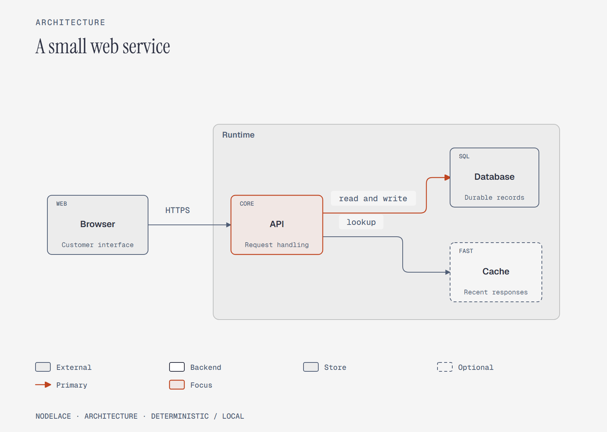
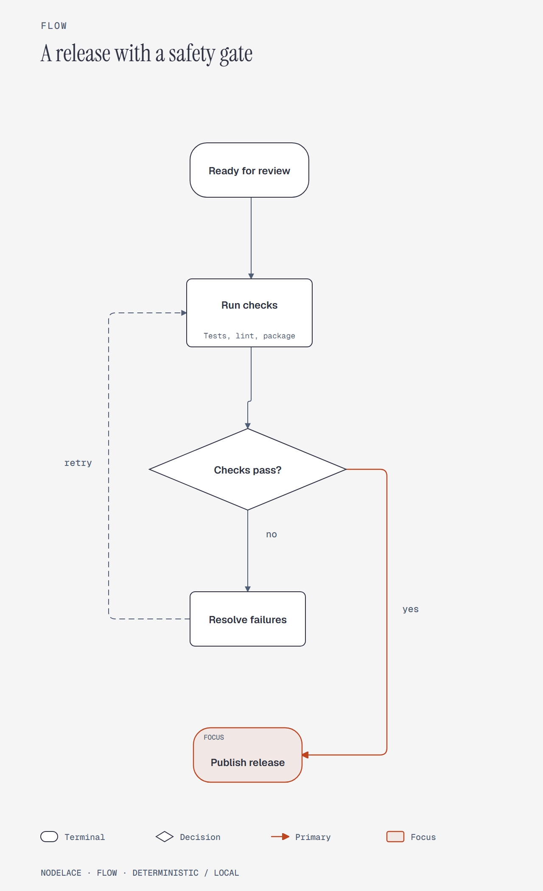
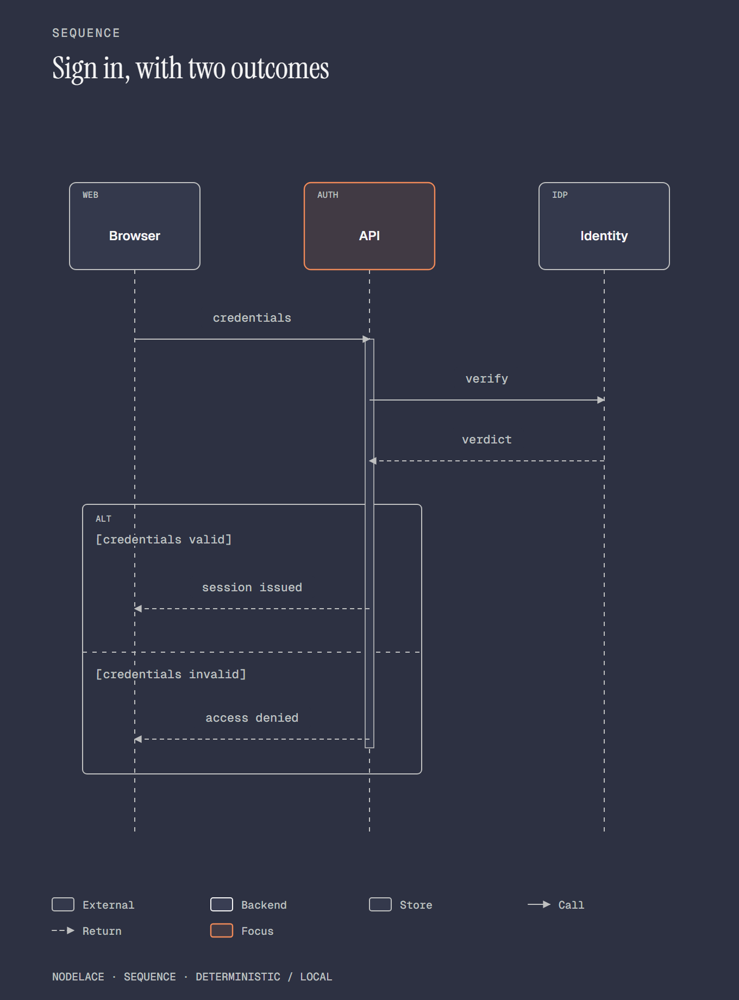

# Nodelace

**Turn a short text description into a diagram, locally.** Nodelace generates
architecture diagrams, flowcharts, and sequence diagrams as SVG, standalone HTML,
or optional PNG. It chooses the layout, routes the connectors, and embeds the fonts.
You write the relationships; you do not need to position every node or write SVG.

Rendering makes no model calls and requires no API key or rendering service.
The same renderer is available for Python and Node.js.



## Choose your package

| | Python | Node.js / npm |
|---|---|---|
| Required runtime | Python 3.11+ | Node.js 22+; no Python installation |
| Install | From the Python repository below | `npm install nodelace` |
| Version documented here | 0.3.0 | 0.3.0, published on npm |
| SVG and HTML dependencies | Python standard library only | Local Pyodide WebAssembly runtime, about 14 MB installed |
| PNG dependencies | Optional Playwright + Chromium | Optional Playwright + Chromium |
| Dedicated guide and examples | [nodelace-python](https://github.com/1aifanatic/nodelace-python) | [nodelace-node](https://github.com/1aifanatic/nodelace-node) |

**Python 0.3.0 is not published to PyPI yet.** Use the source installation below;
`pip install nodelace` is not the installation path documented for this release.
The [npm package](https://www.npmjs.com/package/nodelace) is publicly available.
This repository contains the shared implementation; the two guides provide
language-specific setup and runnable examples.

## Install and render your first diagram

### Python

Clone the Python package and create an isolated environment:

```sh
git clone https://github.com/1aifanatic/nodelace-python.git
cd nodelace-python
python -m venv .venv
```

Activate it using the command for your shell:

```powershell
# Windows PowerShell
.\.venv\Scripts\Activate.ps1
```

```sh
# macOS / Linux
source .venv/bin/activate
```

Install from the checkout:

```sh
python -m pip install .
python -m nodelace --version
```

If your system uses `python3`, use it when creating the environment. On Windows,
`py -3` also works. Activation is optional: run the environment's Python directly,
for example `.venv\Scripts\python.exe` on Windows.

Save this UTF-8 text as `system.diagram`:

```text
architecture "Order service"
node Browser role=external tag=WEB
node API role=backend tag=CORE sublabel="Handle requests"
node Orders role=store tag=SQL
Browser -> API: HTTPS
API => Orders: save order
highlight API
```

Validate it and create both formats:

```sh
python -m nodelace check system.diagram --layout --strict
python -m nodelace render system.diagram
python -m nodelace render system.diagram --theme dark --format html
```

The commands create `system.svg` and `system.html`. Open the HTML file directly
in your browser. The installed `nodelace` command is equivalent to
`python -m nodelace`.

### Node.js / npm

Run these commands in your Node.js project:

```sh
npm install nodelace
npx nodelace init architecture -o system.diagram
npx nodelace check system.diagram --layout --strict
npx nodelace render system.diagram
npx nodelace render system.diagram --theme dark --format html
```

The npm CLI includes `init architecture`, `init flow`, and `init sequence`
starter templates. Python users create a source file or copy a supplied example.
For a global CLI, use `npm install -g nodelace`, then run `nodelace` directly.

## What can you create?

Nodelace supports **three diagram types**. Every type supports both built-in
themes, custom color profiles, SVG/HTML output, and optional PNG export.

| Type | Useful for | Supported features |
|---|---|---|
| `architecture` | Service maps, event pipelines, integrations, AI application architecture | Directed connections, labels, flat groups, roles, tags, sublabels, highlights |
| `flow` | Approvals, release gates, support triage, operational procedures | Decisions, terminals, merges, branching, joins, feedback paths, flat groups |
| `sequence` | API exchanges, authentication, checkout, retries | Ordered calls, returns, asynchronous messages, self-calls, explicit activations, ALT / OPT / LOOP fragments |





Architecture and flow layouts can run `left-to-right` or `top-to-bottom`.
Sequence diagrams place participants horizontally and messages in time order
from top to bottom. See the [complete language reference](docs/DSL.md).

### Syntax you will use most

```text
flow "Release decision"
direction top-to-bottom
node Start shape=terminal
node Review shape=decision label="Ready?"
node Ship shape=terminal
node Fix label="Resolve issues"
Start -> Review
Review => Ship: yes
Review -> Fix: no
Fix -> Review: retry
highlight Ship
```

| Feature | Syntax / choices |
|---|---|
| Edge styles | `A -> B` ordinary, `A --> B` return, `A ~> B` asynchronous, `A => B` primary |
| Explicit sequence call | `call Client -> API: request` |
| Node shapes | `shape=box`, `terminal`, `decision`, `merge` |
| Node roles | `role=default`, `backend`, `store`, `external`, `input`, `optional` |
| Node annotation | `label="Visible name"`, `tag=API`, `sublabel="Short detail"` |
| Flat group | `group Runtime: API, Worker, Database` |
| Focus | `highlight API` |
| Sequence activation | `activate API` and `deactivate API` around a nonempty message range |
| Sequence fragment | `alt "guard"` / `else "other guard"` / `end`; `opt "guard"` / `end`; `loop "guard"` / `end` |

Decision and merge shapes do not accept tags or sublabels. Sequence participants
support box and terminal shapes. Fragment nesting supports one nested level;
an ALT fragment needs two nonempty branches with explicit guards.

## Ten complete examples

Each example includes editable `.diagram` source and **light and dark SVG, HTML,
and PNG files**. HTML embeds its fonts and opens offline. GitHub displays HTML
source; download or clone the repository to open a rendered page.

| Example | Type | Source | Light | Dark |
|---|---|---|---|---|
| 1. Small web service | Architecture | [DSL](examples/showcase/sources/01-web-service.diagram) | [HTML](examples/showcase/rendered/01-web-service-light.html) / [PNG](examples/showcase/rendered/01-web-service-light.png) | [HTML](examples/showcase/rendered/01-web-service-dark.html) / [PNG](examples/showcase/rendered/01-web-service-dark.png) |
| 2. Event processing | Architecture | [DSL](examples/showcase/sources/02-event-processing.diagram) | [HTML](examples/showcase/rendered/02-event-processing-light.html) / [PNG](examples/showcase/rendered/02-event-processing-light.png) | [HTML](examples/showcase/rendered/02-event-processing-dark.html) / [PNG](examples/showcase/rendered/02-event-processing-dark.png) |
| 3. Analytics pipeline | Architecture | [DSL](examples/showcase/sources/03-analytics-pipeline.diagram) | [HTML](examples/showcase/rendered/03-analytics-pipeline-light.html) / [PNG](examples/showcase/rendered/03-analytics-pipeline-light.png) | [HTML](examples/showcase/rendered/03-analytics-pipeline-dark.html) / [PNG](examples/showcase/rendered/03-analytics-pipeline-dark.png) |
| 4. Assistant architecture | Architecture | [DSL](examples/showcase/sources/04-assistant-architecture.diagram) | [HTML](examples/showcase/rendered/04-assistant-architecture-light.html) / [PNG](examples/showcase/rendered/04-assistant-architecture-light.png) | [HTML](examples/showcase/rendered/04-assistant-architecture-dark.html) / [PNG](examples/showcase/rendered/04-assistant-architecture-dark.png) |
| 5. Release gate | Flow | [DSL](examples/showcase/sources/05-release-gate.diagram) | [HTML](examples/showcase/rendered/05-release-gate-light.html) / [PNG](examples/showcase/rendered/05-release-gate-light.png) | [HTML](examples/showcase/rendered/05-release-gate-dark.html) / [PNG](examples/showcase/rendered/05-release-gate-dark.png) |
| 6. Support triage | Flow | [DSL](examples/showcase/sources/06-support-triage.diagram) | [HTML](examples/showcase/rendered/06-support-triage-light.html) / [PNG](examples/showcase/rendered/06-support-triage-light.png) | [HTML](examples/showcase/rendered/06-support-triage-dark.html) / [PNG](examples/showcase/rendered/06-support-triage-dark.png) |
| 7. Expense approval | Flow | [DSL](examples/showcase/sources/07-expense-approval.diagram) | [HTML](examples/showcase/rendered/07-expense-approval-light.html) / [PNG](examples/showcase/rendered/07-expense-approval-light.png) | [HTML](examples/showcase/rendered/07-expense-approval-dark.html) / [PNG](examples/showcase/rendered/07-expense-approval-dark.png) |
| 8. Sign-in outcomes | Sequence | [DSL](examples/showcase/sources/08-sign-in-sequence.diagram) | [HTML](examples/showcase/rendered/08-sign-in-sequence-light.html) / [PNG](examples/showcase/rendered/08-sign-in-sequence-light.png) | [HTML](examples/showcase/rendered/08-sign-in-sequence-dark.html) / [PNG](examples/showcase/rendered/08-sign-in-sequence-dark.png) |
| 9. Checkout and receipt | Sequence | [DSL](examples/showcase/sources/09-checkout-sequence.diagram) | [HTML](examples/showcase/rendered/09-checkout-sequence-light.html) / [PNG](examples/showcase/rendered/09-checkout-sequence-light.png) | [HTML](examples/showcase/rendered/09-checkout-sequence-dark.html) / [PNG](examples/showcase/rendered/09-checkout-sequence-dark.png) |
| 10. Worker retry | Sequence | [DSL](examples/showcase/sources/10-worker-retry-sequence.diagram) | [HTML](examples/showcase/rendered/10-worker-retry-sequence-light.html) / [PNG](examples/showcase/rendered/10-worker-retry-sequence-light.png) | [HTML](examples/showcase/rendered/10-worker-retry-sequence-dark.html) / [PNG](examples/showcase/rendered/10-worker-retry-sequence-dark.png) |

[Open the local gallery](examples/showcase/index.html) ·
[Browse every SVG](examples/showcase/rendered) ·
[Download the sample ZIP](examples/nodelace-10-samples.zip)

The [complete style catalog](examples/style-catalog/README.md) adds 15 rendered
variants covering custom profiles, every output-size preset, shapes, and sequence
features. Open its [offline gallery](examples/style-catalog/index.html) to compare
them. The dedicated [Python examples](https://github.com/1aifanatic/nodelace-python/tree/main/examples)
and [Node examples](https://github.com/1aifanatic/nodelace-node/tree/main/examples)
include these examples and language-specific regeneration commands.

## Themes, color profiles, and output sizes

Use `--theme light` (the default) or `--theme dark`. All styles are rendered
locally; switching themes does not require an AI prompt.

```sh
nodelace render system.diagram --theme light -o system-light.svg
nodelace render system.diagram --theme dark -o system-dark.svg
```

For custom colors, save `colors.toml`:

```toml
[theme]
base = "light"
accent = "#2456a6"
accent_soft = "#e6eefb"
```

```sh
nodelace check system.diagram --profile colors.toml --strict
nodelace render system.diagram --profile colors.toml
```

Use either `--theme` or `--profile`. Profiles accept bounded theme settings,
not arbitrary CSS. A complete example is [blueprint.toml](examples/styles/blueprint.toml).

| Size preset | Canvas | Intended use |
|---|---|---|
| `fit` | Content-sized; default | General diagrams and readable HTML |
| `doc-inline` | 960 × 600 | Inline documentation |
| `doc-wide` | 1280 × 720 | Wide documentation figures |
| `slide-16x9` | 1280 × 720 | Presentation slides, with larger preferred diagram scale |
| `social-square` | 1080 × 1080 | Square graphics |
| `print-a4` | 1120 × 792 | Landscape A4 proportions; pixel dimensions, not a DPI guarantee |

```sh
nodelace check system.diagram --theme dark --size slide-16x9 --strict
nodelace render system.diagram --theme dark --size slide-16x9
```

Fixed canvases can shrink crowded layouts. Use the same theme, profile, and size
when checking and rendering, then inspect the result. HTML preserves text size
with horizontal scrolling on narrow screens. Browser printing fits the diagram
to the page; use the print dialog to save PDF.

## Use it from your code

### Python API

```python
from pathlib import Path
from nodelace import EDITORIAL_DARK, check_diagram, parse_diagram, render

source = 'architecture "Service"\nBrowser -> API: HTTPS'
diagram = parse_diagram(source)
diagnostics = check_diagram(diagram, theme=EDITORIAL_DARK)
for diagnostic in diagnostics:
    print(diagnostic.severity, diagnostic.code, diagnostic.message)

svg = render(diagram, theme=EDITORIAL_DARK, id_prefix="service-map")
html = render(diagram, format="html", theme=EDITORIAL_DARK)
Path("service.svg").write_text(svg, encoding="utf-8")
Path("service.html").write_text(html, encoding="utf-8")
```

`render` accepts source text or a parsed `Diagram` and returns a string. A string
is always diagram text, never a filename. For files, use
`render_file("system.diagram", "system.svg", force=True)`; it applies the CLI's
output-protection policy. Other public helpers include `render_svg`, `render_html`,
`load_theme("colors.toml")`, and optional `export_png(source, "system.png")`.
`layout_diagram` from `nodelace.layout` exposes computed positions and routes.

### JavaScript / TypeScript API

Save this as `render.mjs` and run `node render.mjs`:

```js
import { writeFile } from 'node:fs/promises';
import { check, parse, render } from 'nodelace';

const source = 'architecture "Service"\nBrowser -> API: HTTPS';
console.log(await check(source, { theme: 'dark' }));
const model = await parse(source);
const svg = await render(source, { theme: 'dark', idPrefix: 'service-map' });
const html = await render(source, { theme: 'dark', format: 'html' });
await writeFile('service.svg', svg);
await writeFile('service.html', html);
console.log(model.kind);
```

The three functions are asynchronous. TypeScript declarations are bundled.
CommonJS code can use `await import('nodelace')` inside an async function.
JavaScript's `profile` option takes **TOML text**; the CLI's `--profile` takes a
file path. The JavaScript API renders SVG and HTML; use the CLI for PNG.

The npm package runs the shared Python renderer inside local Pyodide WebAssembly.
It does not launch system Python. Cold startup has overhead, and rendering is
serialized within one process; reuse the API instance and consider worker threads
for a server handling concurrent requests. A browser editing SDK is not included.

## Export PNG

SVG and HTML do not need a browser. PNG uses optional Playwright and Chromium.

For Python, run from the installed package's source checkout:

```sh
python -m pip install ".[png]"
python -m playwright install chromium
python -m nodelace export system.diagram -o system.png --theme dark --scale 2
```

For Node.js:

```sh
npm install playwright
npx playwright install chromium
npx nodelace export system.diagram -o system.png --theme dark --scale 2
```

Browser installation needs network access. Export itself runs locally and blocks
HTTP(S) requests. Scale accepts 1–4; the default is 2. Add `--force` to replace an
existing PNG. On Linux, Chromium may also need system libraries installed through
Playwright's `install --with-deps chromium` command.

## Command behavior and checks

Examples below use `nodelace`; Python users can use `python -m nodelace`, and
project-local npm users can use `npx nodelace`.

```sh
nodelace check system.diagram
nodelace check system.diagram --layout --strict --json
nodelace render system.diagram -o system.html
nodelace render system.diagram -o system.html --force
echo "Browser -> API" | nodelace render - -o - --system-fonts
```

- `check` parses and validates without writing output. `--layout` adds visual
  diagnostics; `--strict` also fails on warnings and implies `--layout`.
- `--json` gives machine-readable check results, including errors and locations.
  Syntax errors, validation errors, and failed strict checks return a nonzero exit.
- Without `-o`, rendering writes a sibling `.svg` or `.html` and replaces it on
  reruns. An explicitly named existing output requires `--force`.
- `-` reads UTF-8 from stdin; `render -o -` writes to stdout. Rendering from stdin
  defaults to stdout. Output filename extensions must match the selected format.
- Fonts embed by default. `--system-fonts` reduces output size but relies on
  fonts installed on the viewer's machine.
- Use a different `--id-prefix` for each SVG instance when inlining repeated
  diagrams into one HTML document.

## Where to use Nodelace

- **Documentation and design reviews:** keep diagrams beside code, review small
  source diffs, and regenerate figures when an architecture changes.
- **CI and documentation builds:** validate `.diagram` files and generate static
  artifacts without an API key or hosted rendering service.
- **Python automation and Node.js tools:** generate reports, onboarding material,
  service maps, runbooks, and internal knowledge-base illustrations.
- **Presentations:** export SVG or PNG at a destination size, or print HTML to PDF.
- **AI-assisted authoring:** give an agent the [compact DSL guide](docs/AGENT-REFERENCE.md)
  and have it write diagram source; Nodelace handles layout and output locally.

Local rendering uses **zero model tokens**. End-to-end token savings depend on
the authoring prompt, revisions, and visual review; no savings percentage is claimed.

## Limits and predictable output

The same source, options, and Nodelace version produce deterministic SVG/HTML.
Rendering sends no telemetry and does not upload diagram content. Package and
optional browser installation need downloads; installed SVG/HTML rendering works offline.

- Supported diagram types are architecture, flow, and sequence. This is not full
  UML or support for every diagram family in the reference design skill.
- Groups are flat; nested groups, swimlanes, a visual editor, and animated diagrams
  are not provided. Sequence participant creation/destruction is not supported.
- A diagram allows at most 50 nodes, 200 edges, and 20 groups. CLI/file input is
  limited to 256 KiB; the Node API applies that source limit too. Profiles are
  limited to 16 KiB. These are ceilings, not recommended diagram sizes.
- Large graphs, many cycles, long labels, and small output canvases can require
  manual refinement. Diagnostics help find problems but cannot guarantee ideal
  composition. Split a dense system into an overview and focused details.
- Bundled fonts cover Latin text. Other Unicode text can use viewer-installed
  fallback fonts; pixels can differ across machines even when SVG bytes match.
- Output retains selectable text, titles, and descriptions. Review readability,
  contrast, and reading order in the final publishing context.

The design was inspired by [diagram-design](https://github.com/cathrynlavery/diagram-design).
Nodelace is an independent implementation and does not claim 100% visual or
feature parity. The [upstream reference manifest](docs/upstream-reference.json)
records the revision reviewed and the selected contracts adopted.

## Troubleshooting

| Problem | What to do |
|---|---|
| `nodelace` is not found | Activate the Python environment and use `python -m nodelace`, or use `npx nodelace` in the npm project. |
| Python registry installation fails | Install this release from the Python repository with `python -m pip install .`; it is not on PyPI yet. |
| Node installation reports an unsupported engine | Check `node --version`; use Node.js 22 or newer. |
| Existing output cannot be replaced | Confirm the destination, then add `--force`. Do not use the source file as the output. |
| PNG reports a missing browser | Install the optional Playwright dependency and run its Chromium installation command above. |
| Strict checks report warnings | Inspect the reported labels, density, crossings, or contrast; shorten text, simplify the diagram, or change the canvas/profile. |
| HTML appears as code on GitHub | Download or clone the repository and open the `.html` file locally. |
| Non-Latin text looks different across machines | Install the same fallback fonts where you render/view, or share a PNG exported on a controlled machine. |

## Repository and development

| Path | Contents |
|---|---|
| [`src/nodelace`](src/nodelace) | Shared Python parser, layout, renderer, diagnostics, and CLI |
| [`npm`](npm) | Node.js adapter, type declarations, CLI, tests, and packaging |
| [`examples/showcase`](examples/showcase) | Ten examples in both themes with source, SVG, HTML, and PNG |
| [`examples/styles`](examples/styles) | Theme and profile examples |
| [`examples/style-catalog`](examples/style-catalog) | Full style coverage, including shapes, sequence features, custom colors, and all size presets |
| [`docs/DSL.md`](docs/DSL.md) | Complete language and validation reference |
| [`docs/ARCHITECTURE.md`](docs/ARCHITECTURE.md) | Implementation and determinism rules |
| [`docs/AGENT-REFERENCE.md`](docs/AGENT-REFERENCE.md) | Compact reference for AI-assisted authoring |

To work on the shared implementation, clone this repository, create and activate
a virtual environment as above, then run:

```sh
python -m pip install -e ".[dev]"
python -m pytest
python -m ruff check .
python -m coverage run -m pytest
python -m coverage report
python -m build
```

For the Node adapter, from `npm/`:

```sh
npm ci
npm test
npm pack
```

`npm run sync` copies the allowlisted renderer sources and assets into the package.
The package has no install-time build scripts. Follow the dedicated
[Python guide](https://github.com/1aifanatic/nodelace-python) or
[Node guide](https://github.com/1aifanatic/nodelace-node) to regenerate their
examples. Report bugs with the smallest reproducing source, package/runtime
version, command/options, and observed output through [GitHub issues](https://github.com/1aifanatic/nodelace/issues).

## License and attribution

Nodelace code is released under the [MIT License](LICENSE). Bundled fonts retain
their licenses; see [THIRD_PARTY_NOTICES.md](THIRD_PARTY_NOTICES.md). Pyodide and
optional Playwright retain their own licenses.

The visual direction was inspired by Kathryn Lavery's
[diagram-design](https://github.com/cathrynlavery/diagram-design). Nodelace does
not package or invoke that AI-oriented skill.
