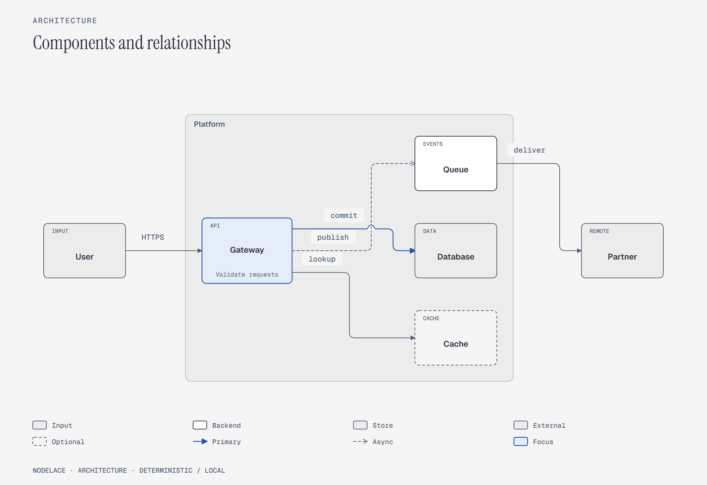

# Diagram styles and output sizes

Nodelace 0.3.0 supports **architecture, flow, and sequence diagrams**. Each type
can use the built-in light or dark theme, or a custom TOML color profile. This
catalog covers every built-in type, theme, node role, shape, arrow kind and canvas
preset. Arbitrary custom colors and every possible topology cannot be enumerated.

Open [index.html](index.html) locally for the visual gallery. GitHub displays PNG
previews directly; download or clone the repository to open the standalone HTML.
All SVG and HTML files embed their fonts. PNG previews were rendered locally at
2x scale. The same sources work in the Python and npm packages.

## Types and themes

| Type and editable source | Light | Dark | Custom blue profile |
|---|---|---|---|
| [Architecture](sources/architecture.diagram) | [HTML](rendered/architecture-light.html) / [PNG](rendered/architecture-light.png) / [SVG](rendered/architecture-light.svg) | [HTML](rendered/architecture-dark.html) / [PNG](rendered/architecture-dark.png) / [SVG](rendered/architecture-dark.svg) | [HTML](rendered/architecture-blueprint.html) / [PNG](rendered/architecture-blueprint.png) / [SVG](rendered/architecture-blueprint.svg) |
| [Flow](sources/flow.diagram) | [HTML](rendered/flow-light.html) / [PNG](rendered/flow-light.png) / [SVG](rendered/flow-light.svg) | [HTML](rendered/flow-dark.html) / [PNG](rendered/flow-dark.png) / [SVG](rendered/flow-dark.svg) | [HTML](rendered/flow-blueprint.html) / [PNG](rendered/flow-blueprint.png) / [SVG](rendered/flow-blueprint.svg) |
| [Sequence](sources/sequence.diagram) | [HTML](rendered/sequence-light.html) / [PNG](rendered/sequence-light.png) / [SVG](rendered/sequence-light.svg) | [HTML](rendered/sequence-dark.html) / [PNG](rendered/sequence-dark.png) / [SVG](rendered/sequence-dark.svg) | [HTML](rendered/sequence-blueprint.html) / [PNG](rendered/sequence-blueprint.png) / [SVG](rendered/sequence-blueprint.svg) |



The custom example uses [blueprint.toml](blueprint.toml):

```toml
[theme]
base = "light"
accent = "#2456a6"
accent_soft = "#e5edf9"
```

Pass its path to CLI `--profile`. The Python API uses `load_theme(path)`; the
JavaScript API uses `{ profile: tomlText }`. Choose either a profile or a built-in
theme for one CLI invocation. Color customization does not replace layout or fonts.

## Feature coverage

| Feature | Example |
|---|---|
| All six roles: default, backend, store, external, input, optional | Architecture |
| Tags, sublabels, flat groups, highlights | Architecture |
| All four shapes: box, decision, merge, terminal | Flow |
| Labeled branches and joins | Flow |
| Ordinary, primary and async edges | Architecture |
| Explicit calls, returns, async and primary messages | Sequence |
| Self-call, activation, ALT with guarded branches, nested OPT | Sequence |
| Left-to-right / top-to-bottom layout | Architecture / flow |

The accompanying ten-example gallery adds a release retry flow, a standalone
LOOP, a standalone OPT and other practical scenarios. Nested fragments are supported
to one level. The nested sequence here intentionally emits the `fragments` editorial
warning: simpler diagrams should prefer one fragment. It has no diagnostic errors,
but `check --strict` exits with code 2 on this warning. Its expected warning is recorded
in [catalog.json](catalog.json); unexpected warnings or any errors fail regeneration.

## Every canvas preset

All six variants use [the same compact source](sources/canvas.diagram). Dimensions
below describe the SVG canvas; the bundled PNGs are 2x these dimensions. HTML keeps
its diagram readable through local horizontal scrolling on narrow screens.

| Preset | SVG canvas | Typical use | Preview |
|---|---|---|---|
| `fit` | Content-based | General documentation | [HTML](rendered/canvas-fit.html) / [PNG](rendered/canvas-fit.png) / [SVG](rendered/canvas-fit.svg) |
| `doc-inline` | 960 x 600 | Inline documentation | [HTML](rendered/canvas-doc-inline.html) / [PNG](rendered/canvas-doc-inline.png) / [SVG](rendered/canvas-doc-inline.svg) |
| `doc-wide` | 1280 x 720 | Wide documentation | [HTML](rendered/canvas-doc-wide.html) / [PNG](rendered/canvas-doc-wide.png) / [SVG](rendered/canvas-doc-wide.svg) |
| `slide-16x9` | 1280 x 720 | Presentation slides; larger preferred diagram scale | [HTML](rendered/canvas-slide-16x9.html) / [PNG](rendered/canvas-slide-16x9.png) / [SVG](rendered/canvas-slide-16x9.svg) |
| `social-square` | 1080 x 1080 | Square images | [HTML](rendered/canvas-social-square.html) / [PNG](rendered/canvas-social-square.png) / [SVG](rendered/canvas-social-square.svg) |
| `print-a4` | 1120 x 792 | Landscape A4-like proportions | [HTML](rendered/canvas-print-a4.html) / [PNG](rendered/canvas-print-a4.png) / [SVG](rendered/canvas-print-a4.svg) |

Use `--size NAME` with both `check` and `render`. A size preset is an output canvas,
not a new diagram family. Fixed canvases can shrink crowded diagrams; inspect the
result. `print-a4` does not set printer paper dimensions or DPI.

## Scope

There are no pie charts, Gantt charts, mind maps, ER notation, swimlanes or full UML
in version 0.3.0. An architecture diagram can represent components in those domains,
but it does not implement their specialized notation. Nodelace does not reproduce
every diagram family or arbitrary design from the reference diagram-design skill.
PDF export is available through a browser's HTML print dialog, not a native format.

See your repository's main README for installation and regeneration commands.
